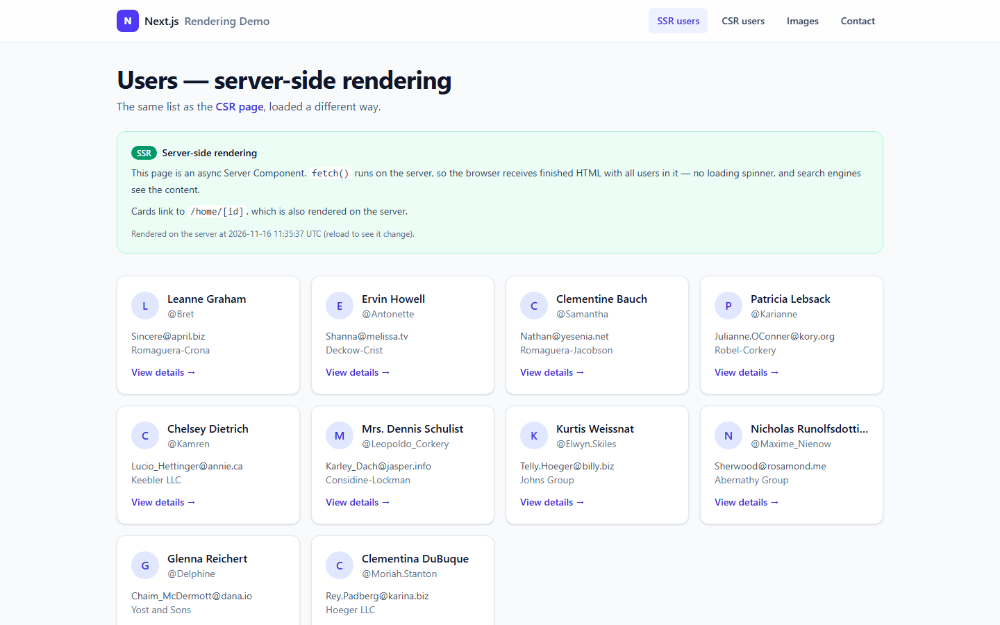

# Next.js Rendering Demo: SSR vs CSR

[](https://next-js-task-first.vercel.app/)

> AZ: Eyni istifadəçi siyahısını server (SSR) və brauzer (CSR) tərəfində yükləyən kiçik Next.js təlim layihəsi.

A small Next.js App Router project that loads the same list of users in two ways, so you can compare
server-side rendering and client-side rendering side by side. It also has a page of `next/image` examples.



## Features

- **/home (SSR)**: an async Server Component fetches the users on every request; the HTML already contains them.
- **/home/[id] (SSR)**: user details rendered on the server, with `generateMetadata` and a real 404 for unknown ids.
- **/users (CSR)**: a Client Component fetches the users in `useEffect`, with skeleton cards, an error state and a retry button.
- **/users/[id] (CSR)**: user details fetched in the browser.
- **/image**: four `next/image` setups (static import with blur placeholder and `priority`, `fill` + `sizes`, remote image with `remotePatterns`, fixed-size SVG).
- **/contact**: links to GitHub and a validated demo form (it says clearly that nothing is sent).
- Responsive layout with a mobile menu, a custom 404 page, and SEO: titles, descriptions, canonical URLs, Open Graph image, favicon, `robots.txt` and `sitemap.xml`.

## Tech stack

Next.js 15 (App Router) · React 19 · TypeScript · Tailwind CSS 4 · [JSONPlaceholder](https://jsonplaceholder.typicode.com/) API

## Run locally

```bash
git clone https://github.com/codelady-ship/next-js-task-first.git
cd next-js-task-first
npm install
npm run dev        # http://localhost:3000 (redirects to /home)
npm run build && npm start   # production build
```

No environment variables are needed.

## Deployment

The site is deployed on Vercel from the `main` branch. Every push to `main` triggers a new production build (`next build`).
`/` redirects to `/home` (see `next.config.ts`).

## What I learned

- The difference between Server and Client Components, and when each one fetches data.
- Why SSR pages are better for SEO: the content is in the first HTML response.
- How the Metadata API works (`metadata`, `generateMetadata`, `robots.ts`, `sitemap.ts`, `opengraph-image.tsx`).
- That a client page cannot export `metadata`, so I keep a small server `page.tsx` and move the browser logic into a client component.
- That a `loading.tsx` boundary makes `notFound()` return status 200, because the response has already started streaming.
- How `next/image` handles sizes, lazy loading, placeholders and remote images.
